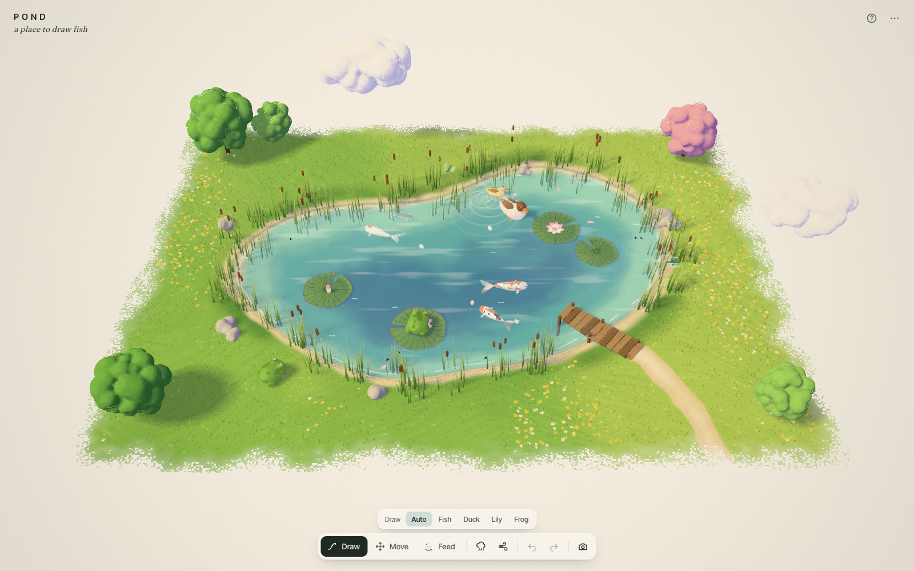
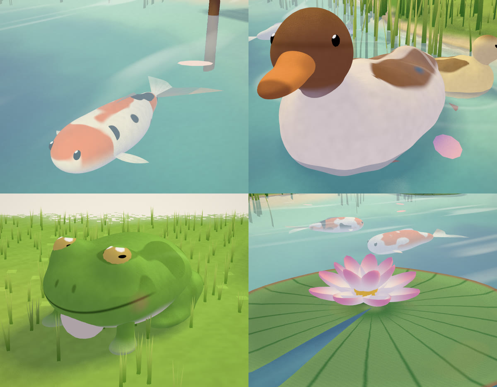
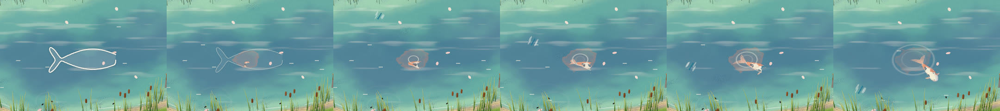
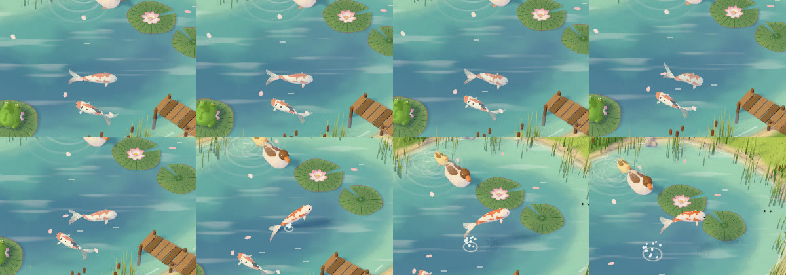
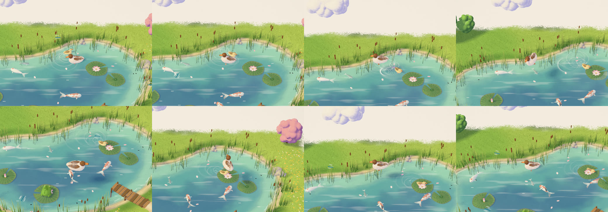
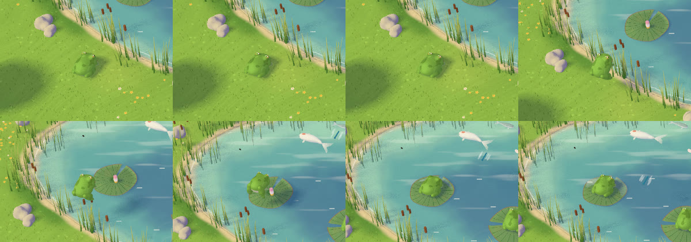

# POND — case study

*Draw on a painted pond and what you drew comes to life.* — [pond-interactive.vercel.app](https://pond-interactive.vercel.app)

## Why a pond

MEADOW turned a loose loop into a woolly sheep on a painted tile of countryside, and people liked the moment the line becomes a creature. POND asks what that moment looks like in water. The brief: the same hand — same painted light, same tile on paper, same interaction grammar and quality bar — with a new world, four new creatures, and a reveal that suits water.

## What was kept, and what was new

MEADOW's code was read first (notes in [docs/MEADOW_STUDY.md](docs/MEADOW_STUDY.md)) and the parts that define its hand were carried over almost unchanged: the perspective camera solved to fit the tile, the two-tone `paintLight` with its lavender shade, the contact-hardening `castLight` shadow filter, the `paintEdge` dry-brush border, surface nets over puff fields in a worker, the brush-sweep `revealClip`, flat poses with cross-faded controllers, the pointer state machine, immutable versioned documents with undo, and the recorder that composites the SVG pen line.

What is new is everything that lives in or near the water: the pond itself, its surface, four creature kinds with their own rigs and behaviours, a shape reader that tells them apart, a watercolour reveal, creatures that notice each other, and pond-wide weather. The art direction is in [docs/ART_DIRECTION.md](docs/ART_DIRECTION.md).

## Water as paint

The pond is an analytic signed-distance field (an ellipse, warped and lobed by a few sines) with identical CPU and GLSL twins, so water colour, the shore line and placement always agree. The ground under it sinks to a basin; the terrain shader paints the bed in depth bands — a pale sandy rim, clear turquoise-green, a deeper teal-blue — whose edges wander like washes laid in passes and dry with a faintly darker back-run. The colour you look down into *is* the water.

Over that, a transparent surface layer composites, in premultiplied paint layers: reflected sky (stronger toward the far bank), slow horizontal light streaks, a few glints, the cool shadow of anything above the water (pads, ducks, a leaping fish, clouds), a dark wet line at the shore and a broken pale band inside it, and ripple rings — a pale crest with a darker trough and a fainter second ring — from a pool of 48 that every splash, paddle, crumb, drop and skater writes to. Anything below the surface passes through one `underwater()` tint that shifts it toward the water colour more the deeper it is.

Around it: instanced reeds and cattails in clumps that sway and lean together in a breeze (with a depth material that shares their sway, so shadows agree), stones, a wooden jetty with a sandy path, bank tufts and flowers coloured from the ground paint, drifting petals, a dragonfly zipping between the reeds, pond skaters dimpling the surface, two puffy trees and clouds that drift along the edges.

## The creatures

All built from code. Bodies are smooth signed-distance unions meshed in a worker; fins, petals and pads are flat shapes. One shader paints every part (chosen by a part id), so they share the reveal, the light, the underwater tint, the wet edge and the selection rim.

- **Koi and minnows.** A soft body with a ridge so it isn't a pill from above; a flowing horizontal tail fan (fins are splayed flat because the camera looks down); pectoral fins that flutter; four painted patterns (kohaku patches, tancho cap, sanke with ink, yamabuki gold). The body bends in the vertex shader with a travelling wave from the tail plus the arc of a turn, and the shadow uses the same bend.
- **Duck.** A boat-shaped body riding low with a perky tail, a warm brown head on a short neck, a soft orange bill. Folded wings are *painted* onto the back — separate wing meshes floating on the body read like sausages from above — and only appear as meshes when they open (flight, shaking). Ducklings are smaller and paler and follow in a line.
- **Lily pad.** A notched, gently domed disc with paler veins and a rose-bronze rim; a flower of two petal rings that open from a pink-tipped bud.
- **Frog.** A squat dumpling with eyes proud of the head, a fine smiling mouth line, a faint blush, folded back legs that straighten to leap, and a cream throat that pulses and balloons forward (so the croak reads from above).

Iterations that mattered: the first duck was a woolly potato with a ball for a head (rebuilt as a boat with a visible neck); fish eyes were googly spheres (flattened and sunk); the frog's eyes vanished into their bumps, then looked like rings, until the lid and pupil were redrawn; a too-strong underwater tint made every koi look white; the duck's white feathers went lilac in shade (gentler shade, as with MEADOW's wool).

## Recognition

A doodle is read with a few robust measurements, never a classifier: elongation along the principal axis, whether one end of the top edge rises well above the middle (a head bump), the deepest concavity of the outline near an end (a tail notch), and which end is fuller. Where it was drawn decides first — only frogs live on land, and a stroke that starts on an unselected pad draws a frog onto it — then the shape picks among fish, duck and lily, with a confidence margin. A close call makes the best guess and offers the alternatives in a chip by the creature for three seconds; the swap is part of the same undo step. Facing comes from the tail (fish), the head (duck) or the fuller end; size from the drawing's length on the water plane, clamped ±15%; a fish drawn much smaller than a koi becomes a minnow. Unit tests cover fixture drawings of each kind in both directions plus ambiguous and degenerate cases.

## The reveal

In water, a soft stain of the creature's pigment spreads on the wet surface with a darker rim where the paint pools, and the creature blooms outward from the drawing's centre with an irregular, wet edge — flat colour first, then light and shade — while the pen line lingers as a ghost; a ring spreads as it settles. On the bank, MEADOW's brush strokes sweep from tail to nose. The shadow is enabled only once 60% is painted. About 1.2 s; half with reduced motion. Creatures are pickable while forming.

## Life

Each kind has its own flat pose (fish: undulation amplitude and rate, turn, pitch, roll, squash, fin, sink; duck: bob, pitch, head, neck, tail, wings, paddle, fluff…; frog: squash, hind legs, throat, croak, tongue, look-up…; pad: bob, tilt, open, spin) and pure time-based behaviours. Controllers cross-fade from the pose actually shown and own root motion:

- Fish glide in S-curves with glide-and-kick undulation, look ahead and turn away from the shore, and stay leashed near where they were put. **Leap**: an anticipation dive (short and thick), a burst (stretched long), an airborne arc that curls at the apex, re-entry with rings and droplets, a glide back to depth — and the heading is chosen first so it always lands in the pond. **Hide** sinks it under the nearest pad, drifting with it. **School** chains the nearest fish behind the leader.
- Ducks drift and pause with a soft V of rings shed off alternate sides of the tail. **Fly** is a pure path function — take-off run with pattering feet, climb, a full loop, a glide down to a skid — and the controller picks, from twenty candidate headings and turn directions, the one that keeps the loop over the tile, lands on open water and circles closest to the pond's middle.
- Frogs hop to the nearest free pad (or along the bank), ride the pad's bob and drift in its own frame, and make it bob and ripple on landing and take-off.
- Pads bob and tilt away from whatever touched them (frogs, ducks nudging past), drift and settle, and turn in a breeze.

## Testing

- **52 unit tests**: shape reading on fixture drawings (fish both ways, duck both ways, lily, ambiguous, degenerate), camera framing (landscape and turned portrait), exact water-plane and bank raycasts, paper misses, far-side shrinking, pond/bank/jetty bounds and clamping, document immutability, reference clean-up, untrusted-file validation (shape, version, kinds, NaN, bounds, ids, caps, dangling references), undo/redo, every behaviour finite over long runs, leap/hop/flight arcs continuous and returning to rest, and controller fuzzing (thousands of random actions: fish stay in water, ducks land on water, frogs stay on a bank or pad, poses never strand).
- **17 Playwright tests in real Chromium with WebGL**, against the dev server and the production build: the PNG export contains paper, water and banks; drawing each kind where it can live creates it facing the right way; a frog drawn on a pad perches on it; paper, tiny scribbles, a duck up the bank and a frog in deep water get messages; the type picker forces a kind and "make it … instead" swaps it in the same undo step; every click action changes the actual pose or position (leap height, hide depth, come-here arrival, school, dabble pitch, preen head turn, flight height and landing, ducklings, bloom, drift, invite, catch tongue, croak, hop); dragging to the far side shrinks a pad on screen; feeding draws fish to crumbs; rain rings and frogs looking up; breeze; undo/redo/clear/reload; PNG download; keyboard; a 15-creature stress run with a flurry of actions, feeding and rain; portrait layout with touch drawing; reduced motion.
- **Visual QA** by looking: close-ups from four angles, reveal strips frame by frame, filmstrips of each action, full compositions, portrait, a demo contact sheet.
- **Media**: `verify-recording.mjs` (H.264 MP4, 1280×720, 237 frames in 4.0 s) and the scripted demo (H.264, 1600×900, 1547 frames in 26.0 s).

## Performance

Apple M2 Pro, headless Chromium (Metal), frames rendered back-to-back with a GPU sync, **machine under other load (load average ≈ 5.4)**:

| Viewport | DPR | Creatures | ms / frame |
|---|---|---|---|
| 1440×900 | 1 | 0 | 7.5 |
| 1440×900 | 1 | 15 | 8.7 |
| 1920×1080 | 1 | 15 | 8.0 |
| 1440×900 | 2 | 0 | 16.8 |
| 1440×900 | 2 | 15 | 17.7 |
| 1920×1080 | 2 | 15 | 23.5 |

Creatures are cheap; the cost is fill (the water surface's ripple loop and the painted ground). At DPR 2 on large screens, MEADOW's dynamic resolution steps the render scale down by median frame time. Shape meshing (~1 s for all kinds) runs in a worker at start-up.

## Limitations

- Seen from above, a leap's height reads mostly through the fish's shadow separating from it and the splash; a lower camera would show it better but lose the illustration.
- Recognition is heuristic: a very lumpy loop can read as a duck. The type picker and the "instead" chip are the escape hatch.
- The croak's sound is a tiny synthesised tone; it is off by default.
- Rain streaks are simple lines; clouds are opaque and drift along the edges.
- Tested in Chromium only (desktop and emulated mobile).

## Future work

Night and dusk palettes; a heron that visits; seasons (pads yellowing, a skin of ice); shareable scene links.
